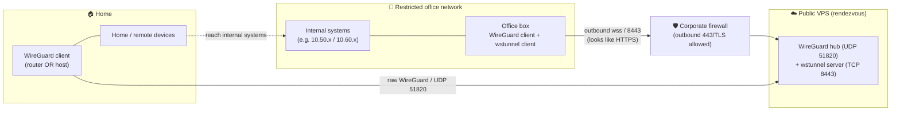
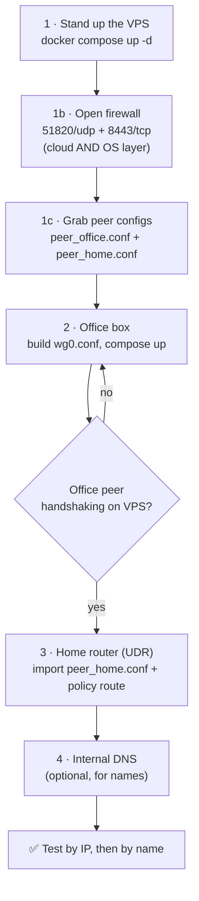
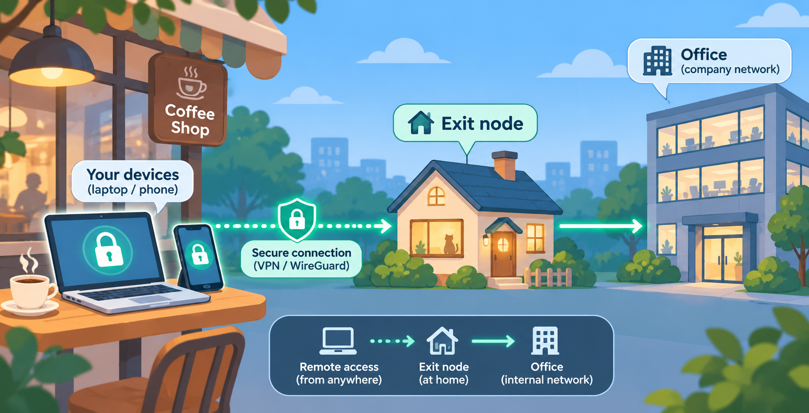

# wg-wstunnel-poc — Reaching an Internal Network From Outside, With No Open Port

A reproducible proof-of-concept that tunnels **WireGuard over a WebSocket (wss)** so a
device on a restricted network can reach internal systems from home — **without opening
any inbound port** on the corporate firewall. It is built for **defensive research and
awareness**: to let security teams reproduce the technique in a lab, see why egress
filtering matters, and test their own controls.

> 📝 **Full write-up / background article:** [Read it here](REPLACE_WITH_YOUR_ARTICLE_URL)
> *(replace this placeholder with your published link)*

---

## ⚠️ Read first — authorized use only

This is a defensive-research PoC. Only run it on networks you **own or are explicitly
authorized to test**. Tunneling out of a network you don't control may violate policy or
law. The goal here is to help defenders **close** this gap — see the
[Defenses](#-defenses-what-actually-stops-this) section. All addresses, keys, and subnets
in this repo are **non-functional examples**; supply your own.

---

## 🎯 What it does


Three pieces cooperate:

- An **office box** (a small Linux device) inside the restricted network. It can reach
  internal systems *and* the internet. It **only dials outward**.
- A **public VPS** that acts as a neutral meeting point. Both sides dial out to it;
  neither opens an inbound port.
- A **home-side WireGuard client** that dials the VPS and routes the office subnets back.
  This can be **any router with a WireGuard client** (UniFi UDR, MikroTik, OpenWRT,
  pfSense, …) to cover the whole home LAN, **or a single host** running WireGuard
  (`wg-quick` / the official app) for just that machine.

The office box runs WireGuard wrapped in **wstunnel**, so its traffic looks like an
ordinary `wss://` HTTPS session leaving the network. The firewall sees normal-looking
outbound TLS; nothing inbound ever happens.

---

## 🗺️ Architecture



**Ports:** `51820/udp` = home router dials the VPS (raw WireGuard). `8443/tcp` = office
box dials the VPS (wss). Use `443` instead if it's free on your VPS; the office firewall
must allow outbound to whichever you pick.

**Why a VPS and not a Cloudflare Worker?** The router speaks **raw WireGuard UDP** and
can't wrap it in WebSocket; a Worker has no UDP listener, so it can never be the endpoint
the router dials. Only a host with a real public UDP port works — a cheap VPS.

---

## 🔁 Setup flow (do it in this order)



---

## 📋 Prerequisites

- A **public VPS** (any cheap one with a public IPv4 and Docker). A free tier works.
- A **small Linux box** on the target network that can run Docker (the "office box").
- A **WireGuard client** on the home side — either a router with a WireGuard VPN client
  (UDR, MikroTik, OpenWRT, pfSense, …) or any host running WireGuard (`wg-quick` / the app).
- `docker` + `docker compose` on the VPS and the office box.

---

## 📁 Repository layout

```
wg-wstunnel-poc/
├── README.md                     ← this file
├── vps/
│   ├── .env.example              ← copy to .env, fill in
│   └── docker-compose.yml        ← WireGuard hub + wstunnel server
├── office/
│   ├── .env.example              ← copy to .env, fill in
│   ├── docker-compose.yml        ← WireGuard client + wstunnel client
│   └── config-office/wg_confs/
│       └── wg0.conf.template     ← generated into wg0.conf by the script
├── vpn-client/
│   ├── README-vpn-client.md      ← home-side WireGuard client steps (router OR host)
│   └── peer_home.conf.example    ← the config imported into the client
└── scripts/
    ├── make-office-conf.sh       ← builds office wg0.conf from peer_office.conf
    └── verify.sh                 ← checks wstunnel flags + hub peers (run on VPS)
```

No real secrets are committed. Every `.env` is a `.env.example`; keys and IPs are placeholders.

---

## 🔑 Values you supply

| Name | Meaning | How to get it |
|---|---|---|
| `VPS_IP` | VPS public IPv4 | `curl -4 -s ifconfig.me` on the VPS |
| `WS_SECRET` | shared wss secret (same both sides) | `openssl rand -hex 24` |
| `OFFICE_ROUTES` | internal subnets to carry (CIDR list) | resolve your internal hosts, collapse to supernets (e.g. `10.50.0.0/16,10.60.0.0/16`) |
| `OFFICE_GW` | office next-hop (optional) | only if the office box can't reach the subnets natively |

---

## 🛠️ Step-by-step

### Step 1 — VPS (rendezvous)

```bash
cd vps
cp .env.example .env         # then edit: VPS_IP, WS_SECRET, OFFICE_ROUTES
docker compose config         # all ${...} resolved? blank = .env not read
docker compose up -d
# grab the two peer configs:
docker exec wg-hub cat /config/peer_office/peer_office.conf   # -> office box (Step 2)
docker exec wg-hub cat /config/peer_home/peer_home.conf       # -> home router (Step 3)
```

### Step 1b — Firewall (two layers!)


Most clouds have a **cloud firewall** *and* an **OS firewall**. A packet must pass
**both**. Open `51820/udp` and `8443/tcp` on each.

- **Cloud layer:** add inbound rules in your provider's console (security group / VCN).
- **OS layer (ufw):** `sudo ufw allow 51820/udp && sudo ufw allow 8443/tcp`
- **OS layer (raw iptables, e.g. stock Ubuntu on some clouds):**
  ```bash
  sudo iptables -L INPUT --line-numbers -n          # find the REJECT line number <N>
  sudo iptables -I INPUT <N> -p udp --dport 51820 -j ACCEPT
  sudo iptables -I INPUT <N> -p tcp --dport 8443  -j ACCEPT
  sudo iptables -L INPUT --line-numbers -n          # ACCEPTs MUST be ABOVE the REJECT
  sudo netfilter-persistent save
  ```
  ⚠️ iptables reads top-down and stops at the first match. If your ACCEPT lines sit
  **below** the `REJECT ... icmp-host-prohibited` line, they never fire.

Test from an outside host:
```bash
nc -vz  <VPS_IP> 8443      # TCP
nc -vzu <VPS_IP> 51820     # UDP
```

### Step 2 — Office box

```bash
cd office
cp .env.example .env         # edit: VPS_IP, WS_SECRET (same as VPS), OFFICE_ROUTES, OFFICE_GW

# can the office box reach the internal subnets natively? (ICMP may be blocked — use curl)
curl -s -o /dev/null -w "%{http_code}\n" http://<an-internal-ip>/
#   reachable -> leave OFFICE_GW empty
#   not       -> set OFFICE_GW to the office next-hop gateway

# save the VPS's peer_office.conf next to the repo, then build wg0.conf:
../scripts/make-office-conf.sh peer_office.conf
docker compose up -d
docker exec wg-office wg show        # handshake within ~30s
```

Confirm on the VPS that the office peer is connected:
```bash
docker exec wg-hub wg show           # 'office' peer: endpoint + recent handshake + transfer > 0
```

### Step 3 — Home-side WireGuard client (router or host)

See [`vpn-client/README-vpn-client.md`](vpn-client/README-vpn-client.md). In short: edit
`peer_home.conf` (`Address` keeps `/24`, set `Endpoint` + `AllowedIPs`), then either:
- **Router:** import it as a WireGuard VPN Client and add a **scoped** policy route
  (Destination = your office subnets, **not** `Any`), or
- **Host:** `sudo cp peer_home.conf /etc/wireguard/wg0.conf && sudo wg-quick up wg0`
  (the config's `AllowedIPs` already scopes what is routed).

### Step 4 — DNS (optional)

Reaching systems by **IP** works with no DNS at all. To use **names**, pick an option from
the [DNS section](#-dns-reaching-internal-systems-by-name) below.

---

## 🌍 Remote access (away from home) — Tailscale exit node



To reach the office while away from home, run **Tailscale** on an always-on box at home
and enable it as an **exit node**. Remote devices select it; all their traffic flows
through home and reaches the office automatically (an exit node routes everything).

Home box (one time):
```bash
sudo tailscale up --advertise-exit-node
echo 'net.ipv4.ip_forward = 1' | sudo tee /etc/sysctl.d/99-tailscale.conf
sudo sysctl -p /etc/sysctl.d/99-tailscale.conf
# then approve the exit node in the Tailscale admin console
```
On the client: select the home box as Exit Node; enable "Use Tailscale subnets" and
"Allow local network access".

**Trade-off:** an exit node routes *all* the device's traffic through home. If you only
want office-bound traffic through home, use Tailscale **subnet routes** instead
(`--advertise-routes=<OFFICE_ROUTES>,<home-LAN>`, approved in the admin console).

> **Watch out — "partially blocked" ≠ "blocked":** a mesh VPN separates its control
> plane from its data plane. A firewall may block the control plane (you'll see a warning)
> while the data plane keeps flowing over 443. Always test whether traffic *actually*
> stops, not just whether a warning appears.

---

## 🌐 DNS: reaching internal systems by name

**DNS is a separate concern from routing** — and the Tailscale exit node does **not**
require Pi-hole (or any specific resolver). Routing gets your packets to the internal
**IP**; DNS is only needed if you want to use **names**. Pick whatever fits:

**Option 0 — Just use IPs (no DNS).**
Simplest for a PoC. `http://10.50.10.10/` works as soon as routing does. Bookmark the IPs.

**Option A — `/etc/hosts` on the entry machine (per-device, quick).**
Good for a single laptop. Add one line per host:
```
10.50.10.10   gitlab.corp.example
10.60.20.20   wiki.corp.example
```
Then flush the cache (macOS: `sudo dscacheutil -flushcache; sudo killall -HUP mDNSResponder`).
⚠️ On macOS/iOS, `*.local` names are hijacked by mDNS and may ignore `/etc/hosts` — use the
IP for those, or give the host a non-`.local` name.

**Option B — a local DNS resolver for the whole network.**
Run **Pi-hole / dnsmasq / unbound / CoreDNS** with custom records, then point your DHCP DNS
(or the router's DNS) at it so every device resolves internal names. Example (dnsmasq):
```
address=/gitlab.corp.example/10.50.10.10
address=/wiki.corp.example/10.60.20.20
```
This is the "set once, works for all LAN devices" option — Pi-hole is just one convenient
implementation, not a requirement.

**Option C — Tailscale split-DNS (for remote devices via the exit node).**
In the Tailscale admin console, add a **restricted/split DNS** nameserver for your internal
domain pointing at your internal resolver's IP. Only that domain is sent there; everything
else uses the device's normal DNS. Note: a device on a very restrictive network may need to
**sync once on an open network** (the DNS config travels over the control plane).

> **Rule of thumb:** for the exit-node path, the remote device resolves names with whatever
> DNS *it* is configured to use. To make internal names resolve remotely, either (B) point
> it at an internal resolver reachable through the tunnel, or (C) use Tailscale split-DNS —
> or just use IPs.

---

## ✅ Verify

```bash
# on the VPS — BOTH peers should handshake
docker exec wg-hub wg show
# from a home/remote device (ICMP often blocked on internal hosts — use curl)
curl -s -o /dev/null -w "%{http_code}\n" http://<an-internal-ip>/
```

Run `./scripts/verify.sh` on the VPS to print the wstunnel flags and the hub peer state.

---

## 🧯 Operations — gotchas

- **Office box: never `docker compose restart wireguard` alone.** wstunnel-client shares
  the wireguard container's network namespace; restarting only wireguard orphans it and
  the office peer silently stops handshaking. **Always restart both** —
  `docker compose restart`, or `docker compose down && docker compose up -d`.
- **Verify the office peer on the VPS** has an `endpoint` and a recent `latest handshake`.
  No endpoint = nothing is reaching the hub.
- **Diagnose by IP before by name** — by-IP tests routing; by-name adds DNS.
- **ICMP is often blocked** on internal hosts — `ping` can time out even when the service
  works. Use `curl`.

### Restart / clean restart (CLI)

```bash
# VPS
cd vps && docker compose down && docker compose up -d && docker exec wg-hub wg show

# Office box — ALWAYS both services together
cd office && docker compose down && docker compose up -d
docker logs -f wstunnel-client        # expect a fresh TLS connection to the VPS
docker exec wg-office wg show
```

---

## 🔎 Troubleshooting

| Symptom | Likely cause / fix |
|---|---|
| office `wstunnel-client` errors loop | 8443 not open on VPS (cloud **and** OS firewall); `WS_SECRET` mismatch; office egress blocks the port |
| `nc` from outside fails, `docker port wg-hub` shows mapping | OS firewall: ACCEPT rule is below the REJECT line — move it above |
| VPS: no `office` handshake / no endpoint | wrong keys in `wg0.conf`; `Endpoint` not `127.0.0.1:51821`; or wireguard restarted alone (orphaned wstunnel) → `down && up` both |
| router "Not Established" | `peer_home.conf` `Address` missing `/24`; wrong `Endpoint`; 51820/udp not open |
| established but no office reach | subnet lists out of sync (VPS `OFFICE_ROUTES` / router `AllowedIPs` / policy route); office `wg0.conf` MASQUERADE must be the no-`-o` form |
| reachable by IP, not by name | internal DNS not configured |

---

## 🛡️ Defenses — what actually stops this

This PoC exists to make the fix obvious. The technique relies on one assumption:
**outbound is trusted.** Remove that and it collapses.

1. **Default-deny egress + allowlist** — the single most effective control. The tunnel
   must reach *some* arbitrary external host; an allowlist severs the whole class at once,
   for every device, managed or not.
2. **NAC / 802.1X + network segmentation** — don't let unmanaged devices onto a segment
   that can reach internal systems.
3. **Block the data plane, not just the control plane** — and **test** that traffic stops.
4. **Zero Trust at the app layer** — identity + device posture, not mere reachability.
5. **Supporting controls** — force internal DNS (block DoH/DoT), SSL deep inspection + app
   control, alert on long-lived steady sessions to a single unfamiliar host, and
   application allowlisting (blocking *installs* isn't the same as blocking *execution* of
   portable binaries).

See the [full write-up](REPLACE_WITH_YOUR_ARTICLE_URL) for the reasoning and real-world
precedents.

---

## 📄 License & disclaimer

Provided as-is for educational and authorized defensive testing only. You are responsible
for how you use it. The author(s) accept no liability for misuse.
